# 基于 MATLAB + VGG-19 的垃圾分类识别系统

用 MATLAB 做的一个垃圾分类识别实验项目：拍一张垃圾的照片丢进去，程序用 VGG-19 网络判断它属于哪一类，界面上会给出回收类型、识别类型和识别率三个结果。做这个的出发点很实际——让人工凭经验分拣效率太低，想试试用现成的预训练网络能不能直接用起来。

没有从零训练网络，而是拿预训练的 VGG-19 做迁移学习：数据集一共 3379 张真实垃圾图片，分 10 个类别（一次性餐盒、纸质包装、烟头、厨余、骨头残渣、果皮、纸类、织物、化妆品瓶、废旧电池），用 imageDatastore 按文件夹读图自动打标签，8:2 切训练集和验证集，图片统一缩放到 224×224。训练用 SGDM 优化器，训好的模型保存下来给推理用。网络输出的原始标签再经过一张标签表（lj9.xlsx）映射，才变成界面上"回收类型 / 识别类型"这种能看懂的字段。

界面是一个简单的 GUI，左边选图片、点开始识别，右边显示图片和识别结果。下面第一组图是识别程序运行时的样子——选了一张塑料袋的图片，识别率 100%；中间是网络结构；后面 10 张是训练数据集里每个类别挑出来的真实样本。

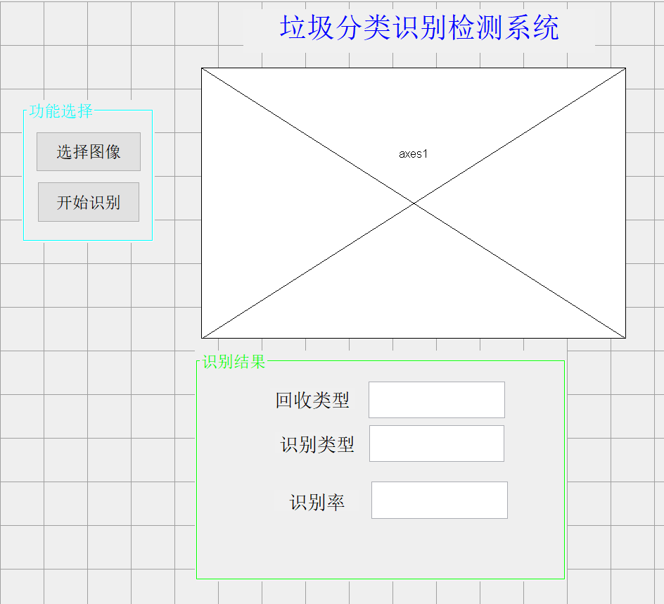

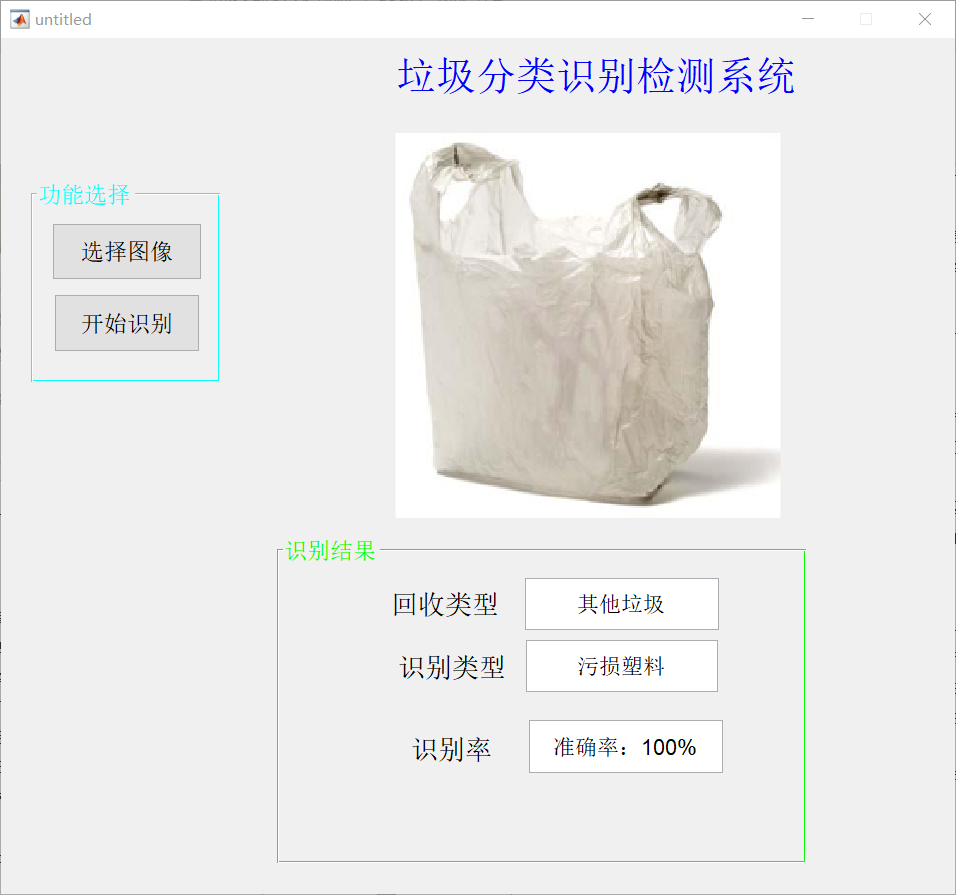

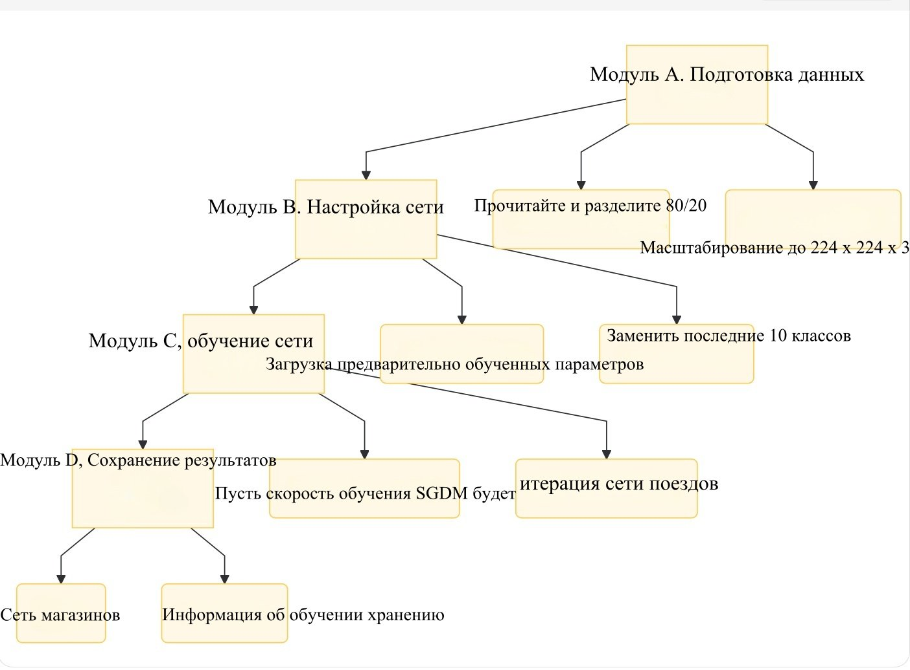

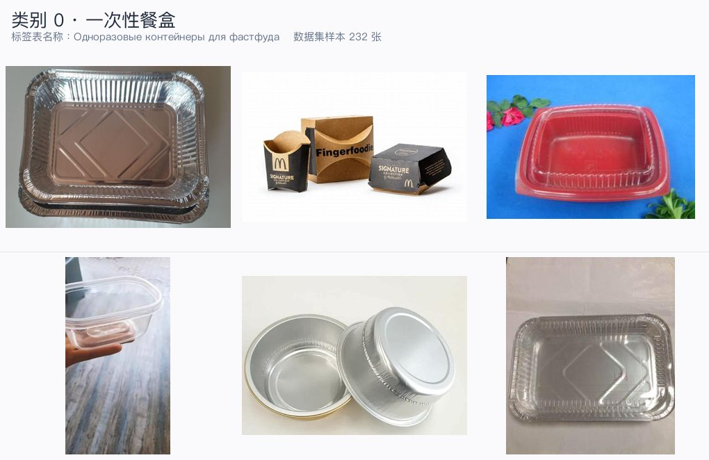

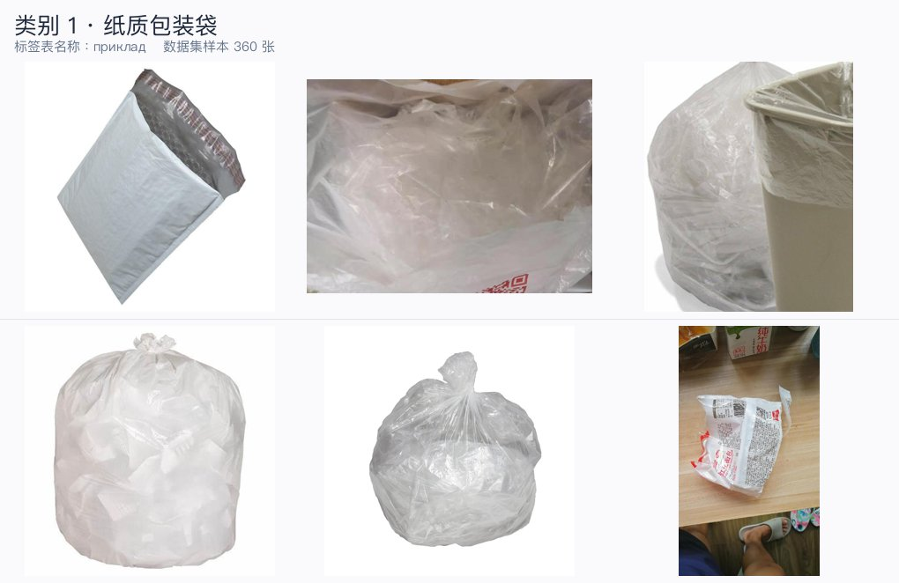

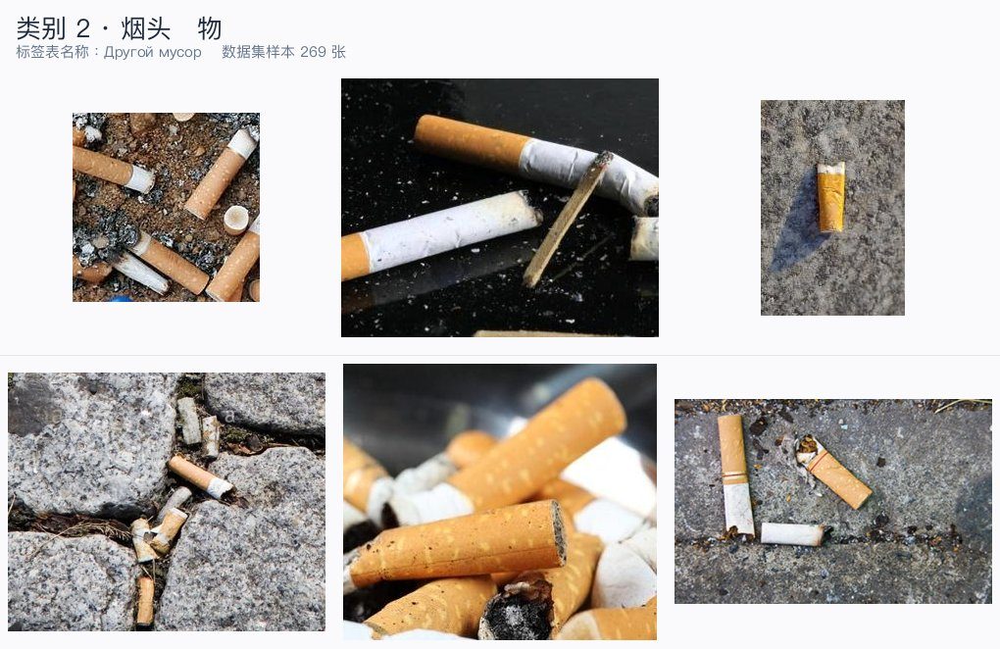

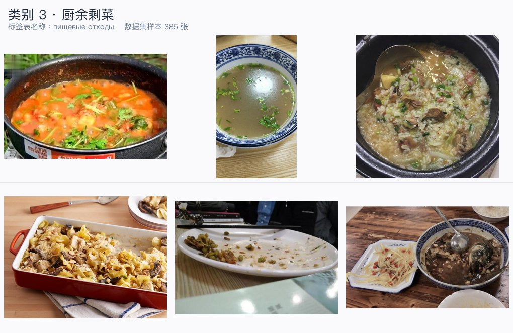

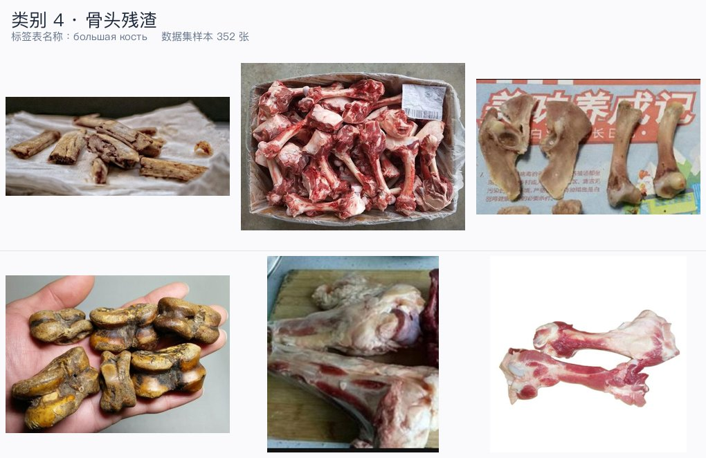

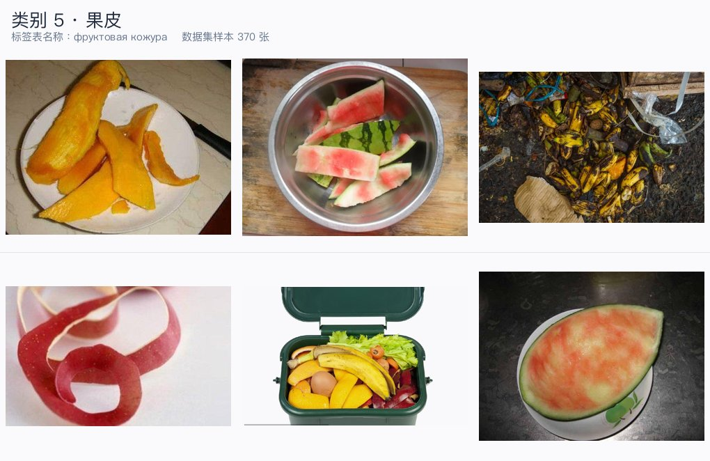

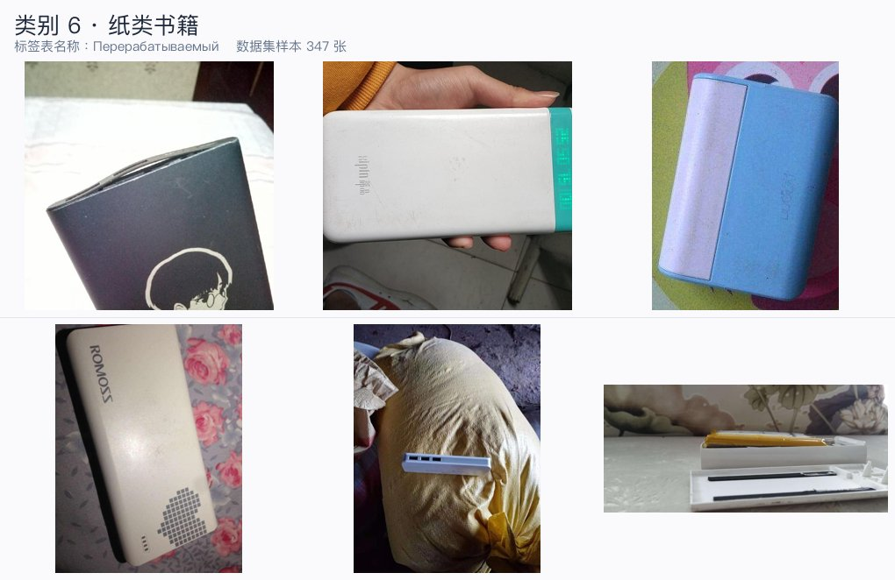

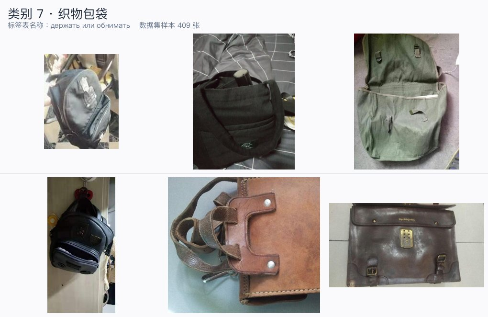

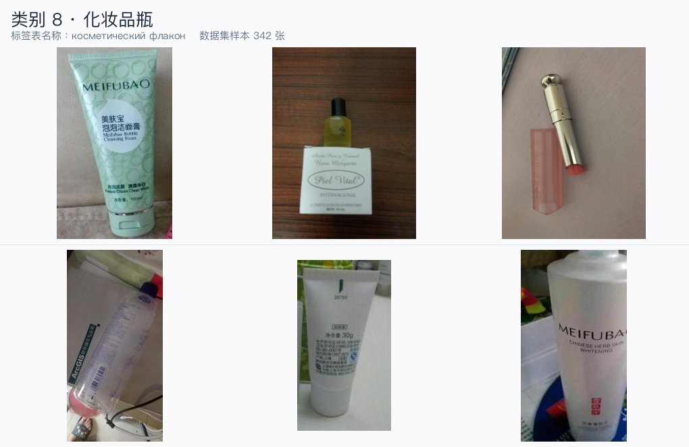

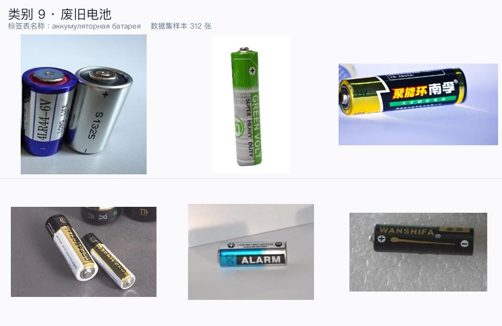
